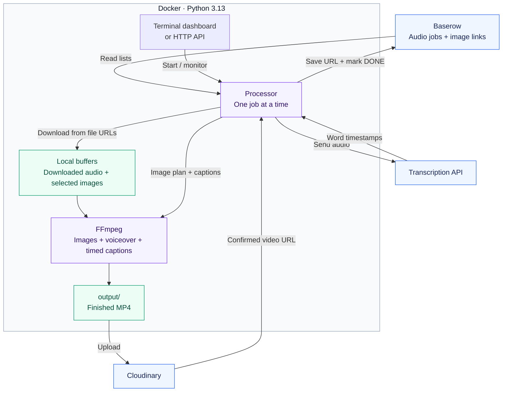
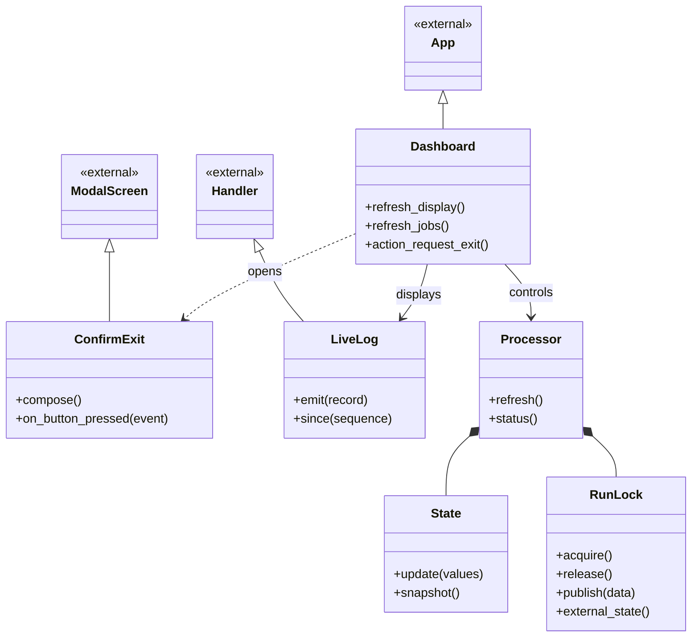
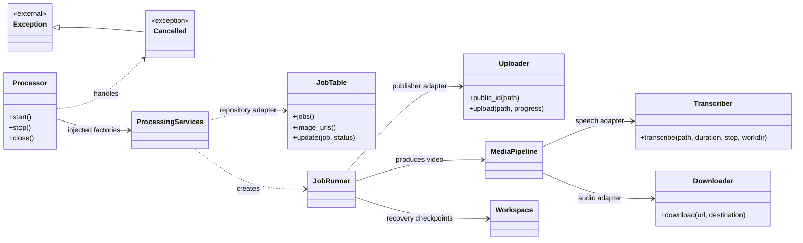
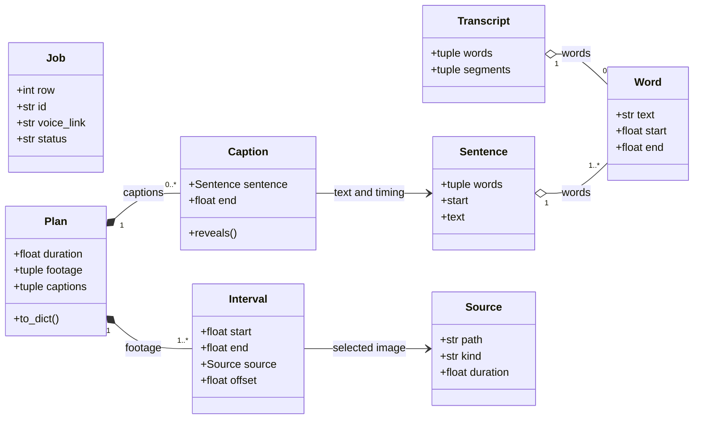

<div align="center">

# Poetry Shorts Maker

### Your voice. Your images. A finished short.

Turn audio links and a table of images into vertical videos with timed captions.


**Baserow → Local processing → Cloudinary → DONE**

[Quick start](#quick-start) · [Architecture](#architecture) · [Class diagrams](#class-diagrams) · [Project layout](#project-layout) · [Operations](docs/operations.md)

</div>

---

## At a glance

| You provide | The app handles | You receive |
| --- | --- | --- |
| Audio links in Baserow | Downloads, API transcription and timed captions | A vertical MP4 with your voiceover |
| Image links in a separate table | Random selection and local image buffering | Selected images fitted to the video |
| Service credentials | Cloudinary upload and Baserow updates | A video link and a `DONE` status |

Runs in **Docker with Python 3.13**. FFmpeg, FFprobe, dependencies and the Special Elite font are included. Transcription uses a hosted API, with no Whisper model download or GPU requirement. Google services are not required.

Jobs run one at a time when you start them from the terminal dashboard or optional HTTP API.

## Quick start

### 1. Get the project

Install [Docker Desktop](https://www.docker.com/products/docker-desktop/) or Docker Engine with the Compose plugin, then start Docker.

```sh
git clone https://github.com/houssamBensiyed/poetry-shorts-maker.git
cd poetry-shorts-maker
```

### 2. Create your Baserow tables

Create a database at [Baserow](https://baserow.io) with two separate tables. Use the field names below exactly.

**Table: `Video Jobs`**

| Field | Type | What to enter |
| --- | --- | --- |
| `ID` | Single line text | Your label, such as `poem-001` |
| `Audio URL` | URL | A direct link to the audio file |
| `Status` | Single line text | `NOT_PROCESSED` |
| `Output File` | Single line text | Leave empty; the app saves the local video path |
| `Output URL` | URL | Leave empty; the app saves the Cloudinary link |
| `Error` | Long text | Leave empty; the app records failures here |

**Table: `Images`**

| Field | Type | What to enter |
| --- | --- | --- |
| `Image URL` | URL | One direct image link per row |
| `ID` | Single line text | Optional label |

Create a **database token** with **Read + Update** access to `Video Jobs` and **Read** access to `Images`. Record both numeric table IDs from Baserow's table URLs or API documentation.

Use editable fields, not formulas. `Status` can also be a single select with `NOT_PROCESSED`, `PROCESSING`, `DONE` and `FAILED`. Images are reusable and need no status field.

### 3. Add your credentials

Copy [`.env.example`](.env.example) to `.env` and fill in the values locally:

```dotenv
BASEROW_API_TOKEN=your_baserow_database_token
CLOUDINARY_API_KEY=your_cloudinary_api_key
CLOUDINARY_API_SECRET=your_cloudinary_api_secret
WHISPER_API_KEY=your_transcription_provider_key
VIDEO_BUILDER_API_KEY=your_private_http_trigger_key
```

Find the Cloudinary credentials in your [Cloudinary dashboard](https://cloudinary.com). The HTTP trigger key is needed only for the optional API. `.env` is excluded from Git and the Docker image.

### 4. Set your table IDs and provider settings

Edit these existing values in [`config.yaml`](config.yaml). Keep the other settings at their defaults to start.

```yaml
baserow:
  api_url: https://api.baserow.io
  table_id: 123456          # Video Jobs table
  images_table_id: 654321   # Images table

cloudinary:
  cloud_name: "YOUR_CLOUD_NAME"

whisper:
  api_url: "https://YOUR_PROVIDER_HOST/v1/audio/transcriptions"
  model: "YOUR_PROVIDER_MODEL"
```

> [!IMPORTANT]
> Naga is the selected transcription provider, but its endpoint, model and timestamp support still need verification. The supplied values are intentionally blank. The provider must return word and segment timestamps. See the [transcription requirements](docs/operations.md#transcription-provider).

Cloudinary needs a cloud name, API key and API secret. The app uses signed uploads and saves **public HTTPS video URLs**. No upload preset is needed.

### 5. Build and start

On Linux, set file ownership for the containers first:

```sh
export LOCAL_UID=$(id -u)
export LOCAL_GID=$(id -g)
```

Then build and open the dashboard in an interactive terminal:

```sh
docker compose build dashboard
docker compose run --rm dashboard
```

Add at least one image link and an audio row with status `NOT_PROCESSED`, then click **Start Processing**. The app saves the completed MP4 locally, uploads it and updates the audio row with its link.

## Architecture

**Baserow holds the lists. Docker creates the video. Cloudinary stores the upload.**



The diagram groups the media stages for readability. For each job, the actual order is:

1. Read the audio job and count the available image links.
2. Download the audio and request its transcription.
3. Plan image changes, randomly select images and download only those selections.
4. Render the full video using the local audio, local images and timed captions.
5. Upload the MP4, then save `Output URL`, `Output File` and `DONE` in Baserow.

### Design choices

| Concern | Implementation |
| --- | --- |
| Entry points | `main.py` opens the Textual dashboard; `api.py` exposes FastAPI endpoints |
| Processing | Both entry points use `Processor`; work runs in a background thread |
| Job tracking | Baserow rows are updated by their stable internal row ID |
| File access | Generic HTTP(S) downloads from the links stored in Baserow |
| Rendering | Pure timeline planning, ASS captions and local FFmpeg processing |
| Upload completion | `DONE` is written only after Cloudinary confirms the complete upload |
| Concurrency | A shared Docker volume holds the process lock and published status |
| Recovery | Completed videos and failure checkpoints remain available locally |

The shared lock coordinates containers within the same Compose project. It does not coordinate separate computers. See [running safely](docs/operations.md#running-safely).

## Class diagrams

These diagrams show the main application services and data models. The [architecture and extension guide](docs/ARCHITECTURE.md) describes the complete set of interfaces and extension points. Only selected public methods are shown. Classes marked `external` belong to Python or Textual.

<details>
<summary><strong>Application services: dashboard, processing and integrations</strong></summary>

Solid arrows indicate references, dotted arrows indicate use, diamonds indicate owned objects, and triangles indicate inheritance.

**Dashboard and shared runtime**



**Processing and integrations**

`Processor` coordinates the queue through injected services. `JobRunner` owns recovery and publication; `MediaPipeline` owns the media stages. Concrete providers are selected in `app/bootstrap.py`.



</details>

<details>
<summary><strong>Data models: jobs, words, images and the video timeline</strong></summary>

These are frozen dataclasses. `JobTable` produces `Job` records, `Transcriber` returns a `Transcript`, and `build_plan()` returns a `Plan` for rendering. A hollow diamond groups shared objects; a filled diamond indicates composition.



`Source` and the rendering helpers also support video sources internally. The application workflow supplies only images from Baserow; there is no local footage input folder.

</details>

### Modules without application classes

| Module | Responsibility |
| --- | --- |
| [`config.py`](app/config.py) | Load YAML, resolve paths and validate required settings |
| [`images.py`](app/images.py) | Download selected images, verify decoding and return local sources |
| [`footage.py`](app/footage.py) | Inspect media with FFprobe and measure audio duration |
| [`captions.py`](app/captions.py) | Lay out words and write timed ASS subtitles |

[`timeline.py`](app/timeline.py) also groups words into sentences and builds the plan. [`video_builder.py`](app/video_builder.py) renders videos; [`ffmpeg.py`](app/ffmpeg.py) runs subprocesses and [`cancellation.py`](app/cancellation.py) defines shared cancellation.

## Project layout

```text
poetry-shorts-maker/
├── app/                    Application classes and processing functions
├── assets/fonts/           Bundled Special Elite font and license
├── buffer/
│   ├── voiceovers/         Downloaded original audio
│   └── images/             Selected images downloaded for each job
├── docs/                   Operations guide and README badge assets
├── logs/                   Rotating application logs
├── output/                 Completed MP4 files
├── temp/                   Job work files and recovery checkpoints
├── tests/                  Unit and integration tests
├── main.py                 Terminal dashboard entry point
├── api.py                  Optional HTTP API entry point
├── config.yaml             Service and video settings
├── .env.example            Credential template
├── Dockerfile              Python 3.13 and FFmpeg runtime
├── compose.yaml            Dashboard, API and persistent storage
├── requirements.txt        Dependency constraints
└── requirements.lock       Pinned Python dependencies
```

The buffers, output, logs and temporary files live on your computer through Docker mounts. Successful jobs clear their temporary work files; downloaded media and completed videos remain. The `footage` YAML section controls image timing and random selection, not a folder.

## Output and controls

| Setting | Default behavior |
| --- | --- |
| Video | 1080 × 1920, 30 FPS, H.264 with AAC audio |
| Image changes | A sentence with at least 3 words starts a new selection |
| Short sentences | Keep the current image |
| Captions | Reveal words at their timestamps; hold through silence |
| Font | Special Elite, bundled locally |
| Upload | Signed Cloudinary upload in 10 MB chunks |
| Completion | Save the uploaded URL and mark the audio row `DONE` |

Use **Refresh Jobs** to read counts, **Start Processing** to run pending rows, and **Stop Processing** to stop safely. Mouse clicks and Tab/Enter are supported. The dashboard can open before credentials are configured.

For API commands, tuning, supported file links and recovery, see the **[operations guide](docs/operations.md)**.

## Validation

The maintenance refactor passed **117 tests** locally on Python 3.14, plus lint, formatting and core type checks. The Docker runtime uses Python 3.13. See [the code review](docs/CODE_REVIEW.md) for verification scope and remaining limitations. Run the suite with:

```sh
docker compose run --rm --no-deps dashboard python -m pytest -q
```

Coverage includes real local HTTP downloads, FFmpeg renders and caption-frame checks, random image selection, API authentication, cancellation, upload signatures and failure recovery. External Baserow, transcription and Cloudinary responses are mocked in tests.

Live service processing still requires your table IDs, credentials and a verified transcription endpoint and model. The test results do not claim a successful live upload or paid transcription request.


## Architecture and contributing

Start with the [architecture and extension guide](docs/ARCHITECTURE.md) before adding a provider or media stage. Run coordination, media processing, job recovery and provider wiring have separate modules; `ProcessingServices` and the protocols in `app/contracts.py` provide explicit extension points.

The [critical code review](docs/CODE_REVIEW.md) records the findings addressed by the refactor and remaining limitations. Development checks and pinned tools are documented in the architecture guide; CI is configured to run linting, formatting, core type checks and tests on Python 3.13 and 3.14.
