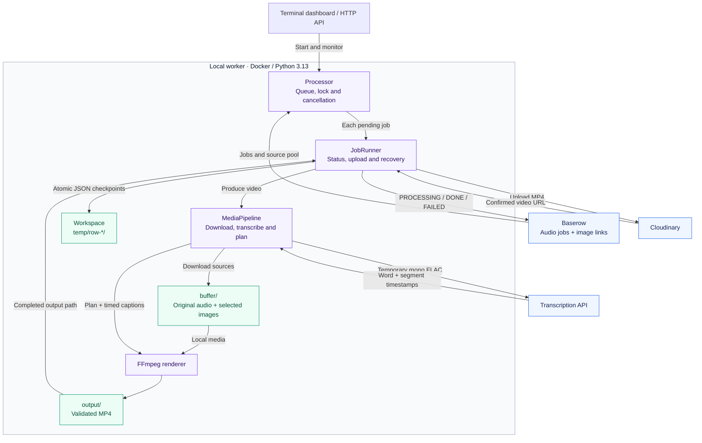
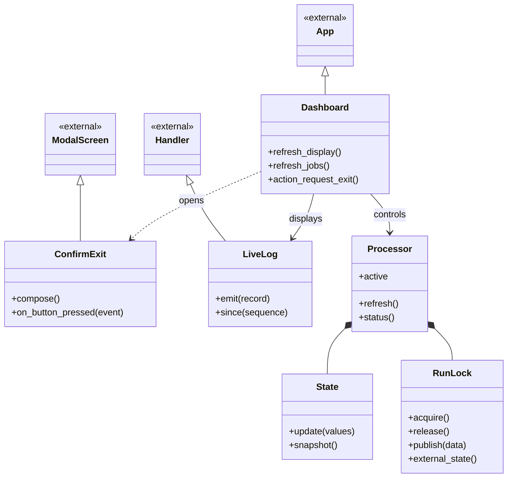
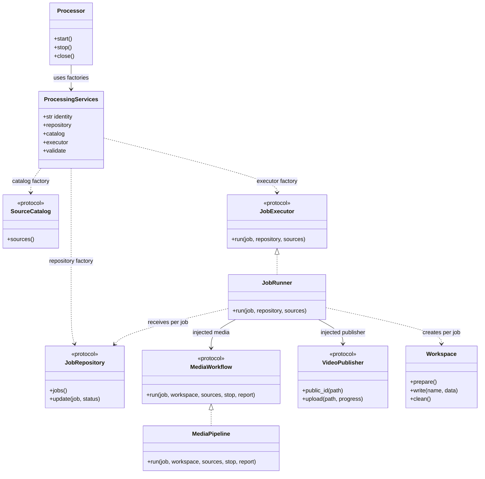
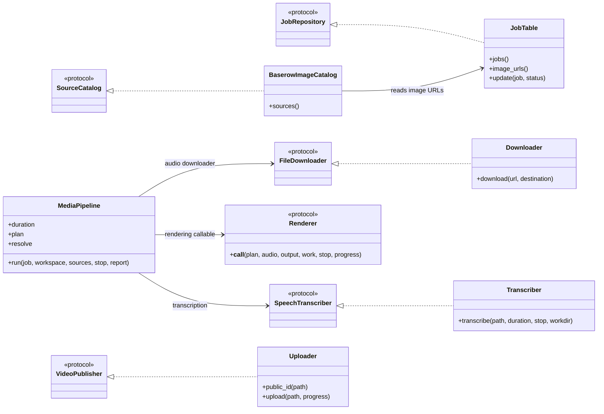
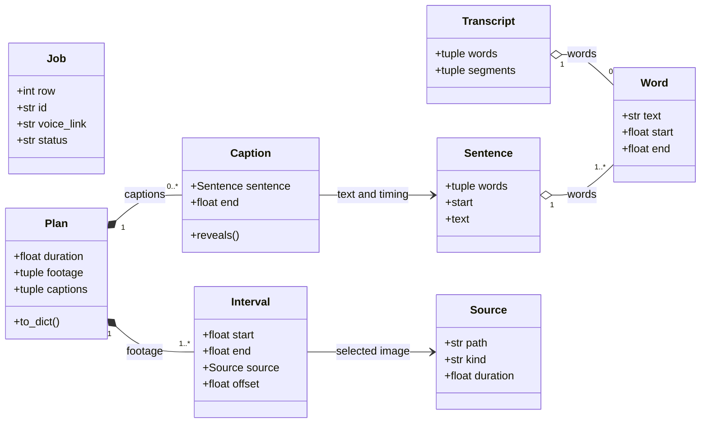

<div align="center">

# Poetry Shorts Maker

### Your voice. Your images. A finished short.

Turn audio links and a table of images into vertical videos with timed captions.


**Baserow → Local processing → Cloudinary → DONE**

[Quick start](#quick-start) · [Architecture](#architecture) · [Class diagrams](#class-diagrams) · [Project layout](#project-layout) · [Operations](docs/operations.md) · [Extension guide](docs/ARCHITECTURE.md) · [Code review](docs/CODE_REVIEW.md)

</div>

---

## At a glance

| You provide | The app handles | You receive |
| --- | --- | --- |
| Audio links in Baserow | Downloads, API transcription and timed captions | A vertical MP4 with your voiceover |
| Image links in a separate table | Random selection and local image buffering | Selected images fitted to the video |
| Service credentials | Cloudinary upload and Baserow updates | A video link and a `DONE` status |

Runs in **Docker with Python 3.13**. FFmpeg, FFprobe, dependencies and the Special Elite font are included. Transcription uses a hosted API, with no Whisper model download or GPU requirement. Google services are not required.

Jobs run one at a time when you start them from the terminal dashboard or optional HTTP API.

## Quick start

### 1. Get the project

Install [Docker Desktop](https://www.docker.com/products/docker-desktop/) or Docker Engine with the Compose plugin, then start Docker.

```sh
git clone https://github.com/houssamBensiyed/poetry-shorts-maker.git
cd poetry-shorts-maker
```

### 2. Create your Baserow tables

Create a database at [Baserow](https://baserow.io) with two separate tables. Use the field names below exactly.

**Table: `Video Jobs`**

| Field | Type | What to enter |
| --- | --- | --- |
| `ID` | Single line text | Your label, such as `poem-001` |
| `Audio URL` | URL | A direct link to the audio file |
| `Status` | Single line text | `NOT_PROCESSED` |
| `Output File` | Single line text | Leave empty; the app saves the local video path |
| `Output URL` | URL | Leave empty; the app saves the Cloudinary link |
| `Error` | Long text | Leave empty; the app records failures here |

**Table: `Images`**

| Field | Type | What to enter |
| --- | --- | --- |
| `Image URL` | URL | One direct image link per row |
| `ID` | Single line text | Optional label |

Create a **database token** with **Read + Update** access to `Video Jobs` and **Read** access to `Images`. Record both numeric table IDs from Baserow's table URLs or API documentation.

Use editable fields, not formulas. `Status` can also be a single select with `NOT_PROCESSED`, `PROCESSING`, `DONE` and `FAILED`. Images are reusable and need no status field.

### 3. Add your credentials

Copy [`.env.example`](.env.example) to `.env`, then fill in the values locally:

```sh
cp .env.example .env
```

```dotenv
BASEROW_API_TOKEN=your_baserow_database_token
CLOUDINARY_API_KEY=your_cloudinary_api_key
CLOUDINARY_API_SECRET=your_cloudinary_api_secret
WHISPER_API_KEY=your_transcription_provider_key
VIDEO_BUILDER_API_KEY=your_private_http_trigger_key
```

Find the Cloudinary credentials in your [Cloudinary dashboard](https://cloudinary.com). The HTTP trigger key is needed only for the optional API. `.env` is excluded from Git and the Docker image.

### 4. Set your table IDs and provider settings

Edit these existing values in [`config.yaml`](config.yaml). Keep the other settings at their defaults to start.

```yaml
baserow:
  api_url: https://api.baserow.io
  table_id: 123456          # Video Jobs table
  images_table_id: 654321   # Images table

cloudinary:
  cloud_name: "YOUR_CLOUD_NAME"

whisper:
  api_url: "https://YOUR_PROVIDER_HOST/v1/audio/transcriptions"
  model: "YOUR_PROVIDER_MODEL"
```

> [!IMPORTANT]
> Naga is the selected transcription provider, but its endpoint, model and timestamp support still need verification. The supplied values are intentionally blank. The provider must return word and segment timestamps. See the [transcription requirements](docs/operations.md#transcription-provider).

Cloudinary needs a cloud name, API key and API secret. The app uses signed uploads and saves **public HTTPS video URLs**. No upload preset is needed.

### 5. Build and start

On Linux, set file ownership for the containers first:

```sh
export LOCAL_UID=$(id -u)
export LOCAL_GID=$(id -g)
```

Then build and open the dashboard in an interactive terminal:

```sh
docker compose build dashboard
docker compose run --rm dashboard
```

Add at least one image link and an audio row with status `NOT_PROCESSED`, then click **Start Processing**. The app saves the completed MP4 locally, uploads it and updates the audio row with its link.

## Visual testing with n8n

Import [n8n/poetry-shorts-visual-demo.json](n8n/poetry-shorts-visual-demo.json) into n8n and click **Execute workflow** to inspect the entire pipeline with sample data, sequential jobs, captions, recovery checkpoints and success/failure branches. This offline demo simulates media and provider operations without creating files or making paid requests.

A second workflow, [n8n/poetry-shorts-api-runner.json](n8n/poetry-shorts-api-runner.json), starts and monitors real processing through the Python API. See the [n8n guide](n8n/README.md) for imports, credentials, example results and an optional local Docker setup.

## Architecture

**Baserow holds the lists. Docker creates the video. Cloudinary stores the upload.**



[`bootstrap.py`](app/bootstrap.py) selects the default providers and builds `ProcessingServices`. The coordinator and job workflow use interfaces so another repository, publisher or transcription provider can be selected through composition. See the [extension examples](docs/ARCHITECTURE.md#replace-the-publisher).

For each run, `Processor` takes a job snapshot and reads the image pool. For each pending job:

1. `JobRunner` creates a unique workspace and marks the row `PROCESSING`.
2. `MediaPipeline` downloads and probes the audio, then requests timestamped transcription.
3. It plans image changes, downloads only the selected images, and renders a validated MP4.
4. `JobRunner` records the output and intended upload ID, uploads the video, and saves the confirmed result.
5. It marks the row `DONE`, then removes successful temporary work. Audio, selected images and the MP4 remain local.

Failures retain available recovery information and trigger an independent attempt to mark the row `FAILED`. A failed diagnostic write does not prevent later jobs from running. See [recovery](docs/operations.md#recovery) before retrying an upload.

### Design choices

| Concern | Implementation |
| --- | --- |
| Entry points | `main.py` opens the Textual dashboard; `api.py` exposes authenticated FastAPI endpoints |
| Run coordination | `Processor` owns the worker thread, queue counts, cancellation and shared lock |
| Per-job lifecycle | `JobRunner` owns status transitions, publication and recovery |
| Media workflow | `MediaPipeline` receives a downloader, transcriber, duration probe, planner, resolver and renderer |
| Provider selection | `bootstrap.py` wires concrete adapters to the protocols in `contracts.py` |
| Job tracking | `JobRepository` updates jobs; the Baserow adapter uses stable internal row IDs |
| Image catalog | `SourceCatalog` supplies sources independently of job updates |
| Output safety | The renderer finalizes validated MP4s; `Workspace` replaces JSON checkpoints atomically |
| Completion | `DONE` requires an acknowledged upload and repository update; cleanup follows completion |
| Concurrency | A shared Docker volume holds the process lock and published status |

The shared lock coordinates containers within the same Compose project. It does not coordinate separate computers. See [running safely](docs/operations.md#running-safely).

## Class diagrams

These diagrams show the main application services and data models. The [architecture and extension guide](docs/ARCHITECTURE.md) describes the complete set of interfaces and extension points. Only selected public methods are shown. Classes marked `external` belong to Python or Textual.

<details>
<summary><strong>Application services: dashboard, processing and integrations</strong></summary>

Solid arrows indicate references, dotted arrows indicate dependencies, and filled diamonds indicate owned objects. A solid line ending in a triangle shows inheritance. A dotted line ending in a triangle shows structural protocol conformance; adapters do not need to inherit from the protocol.

**Dashboard and shared runtime**



**Queue, job lifecycle and media workflow**

The factories in `ProcessingServices` create repositories, catalogs and executors at run time. `JobRunner` and `MediaPipeline` satisfy the execution protocols structurally.



**Default provider adapters**

These are the default selections in [`bootstrap.py`](app/bootstrap.py), rather than dependencies constructed by `Processor`.



The pipeline's duration probe, planner and source resolver are injected functions. The default resolver buffers selected images; the rendering callable wraps `video_builder.render`. `Reporter` callbacks publish stage/progress updates. Shared `Cancelled` exceptions and `check_cancel()` live in `cancellation.py`; FFmpeg subprocess execution lives in `ffmpeg.py`.

</details>

<details>
<summary><strong>Data models: jobs, words, images and the video timeline</strong></summary>

The domain records below are frozen dataclasses. `Job` and `Transcript` live in `models.py`; the timeline records live in `timeline.py`. `JobTable` produces `Job` records, `Transcriber` returns a `Transcript`, and `build_plan()` returns a `Plan` for rendering. A hollow diamond groups shared objects; a filled diamond indicates composition.



`UploadResult` in `models.py` is a typed dictionary containing `url`, `public_id` and `bytes`; publishers return it after confirming completion. `Workspace` in `artifacts.py` is a frozen dataclass holding work, output, audio and image paths.

`Source` and the rendering helpers also support video sources internally. The application workflow supplies only images from Baserow; there is no local footage input folder.

</details>

### Code map

| Module | Responsibility |
| --- | --- |
| [`processor.py`](app/processor.py) | Run ownership, thread lifecycle, queue iteration and observable state |
| [`execution.py`](app/execution.py) | One job's status, upload and recovery policy; `MediaWorkflow` contract |
| [`pipeline.py`](app/pipeline.py) | Media stages from download through rendering |
| [`bootstrap.py`](app/bootstrap.py) | Default providers, media strategies and service factories |
| [`contracts.py`](app/contracts.py) | Structural protocols and the `ProcessingServices` factory bundle |
| [`models.py`](app/models.py) / [`timeline.py`](app/timeline.py) | Shared values, sentence grouping and timeline validation |
| [`artifacts.py`](app/artifacts.py) / [`state.py`](app/state.py) | Per-job checkpoints, process locking and state snapshots |
| [`jobs.py`](app/jobs.py) / [`uploads.py`](app/uploads.py) / [`transcription.py`](app/transcription.py) | Baserow, Cloudinary and hosted transcription adapters |
| [`downloads.py`](app/downloads.py) / [`images.py`](app/images.py) | Direct downloads and selected-image decoding/validation |
| [`footage.py`](app/footage.py) / [`captions.py`](app/captions.py) / [`video_builder.py`](app/video_builder.py) | Media probing, ASS captions and validated FFmpeg renders |
| [`cancellation.py`](app/cancellation.py) / [`ffmpeg.py`](app/ffmpeg.py) | Cooperative cancellation and cancellable subprocess execution |
| [`config.py`](app/config.py) | YAML validation and separately composable provider checks |

### Reading the source

The Python application modules, classes and functions include docstrings explaining
what they do and why their responsibilities are separate. The larger operations
describe inputs, outputs, filesystem/network effects, cancellation and failure
handling. Data-model docstrings explain field meanings and timing units; protocol
docstrings define the behavior replacement providers must preserve.

Follow this reading order to trace a complete job:

1. [`bootstrap.py`](app/bootstrap.py) assembles the providers without starting work,
   allowing the dashboard to open before credentials are ready.
2. [`processor.py`](app/processor.py) owns the worker and shared queue lock so the
   dashboard and API cannot process the same queue concurrently on shared lock storage.
3. [`execution.py`](app/execution.py) records render/upload checkpoints and waits for
   an acknowledged `DONE` update so a later failure retains evidence for recovery.
4. [`pipeline.py`](app/pipeline.py) orders media preparation independently of remote
   status and publication, making individual media dependencies replaceable.
5. [`timeline.py`](app/timeline.py), [`captions.py`](app/captions.py) and
   [`video_builder.py`](app/video_builder.py) explain sentence-based image changes,
   stable word-reveal layout and validation before the final MP4 becomes visible.

An editor's hover/help view displays these docstrings. For example, inspect the job
lifecycle locally with `.venv/bin/python -m pydoc app.execution.JobRunner.run`.
See the [documentation conventions](docs/ARCHITECTURE.md#source-documentation)
when changing behavior or adding an adapter.

## Project layout

```text
poetry-shorts-maker/
├── .github/workflows/ci.yml Lint, formatting, type checks and tests
├── app/                    Application services, protocols and provider adapters
├── assets/fonts/           Bundled Special Elite font and license
├── buffer/
│   ├── voiceovers/         Downloaded original audio
│   └── images/             Selected images downloaded for each job
├── docs/
│   ├── ARCHITECTURE.md      Extension guide, dependency diagram and job sequence
│   ├── CODE_REVIEW.md       Findings, fixes and remaining limitations
│   ├── operations.md       Configuration, HTTP API and recovery
│   └── assets/             README badges
├── n8n/                    Importable visual demo, live API runner and optional editor setup
├── logs/                   Rotating application logs
├── output/                 Completed MP4 files
├── temp/                   Job work files and recovery checkpoints
├── tests/                  Unit and integration tests
├── main.py                 Terminal dashboard entry point
├── api.py                  Optional HTTP API entry point
├── config.yaml             Service and video settings
├── .env.example            Credential template
├── Dockerfile              Python 3.13 and FFmpeg runtime
├── compose.yaml            Dashboard, API and persistent storage
├── pyproject.toml          Pytest, Ruff and core mypy configuration
├── requirements-dev.txt    Pinned development tools and runtime dependencies
├── requirements.txt        Runtime dependency constraints
└── requirements.lock       Pinned runtime dependencies
```

The buffers, output, logs and temporary files live on your computer through Docker mounts. Successful jobs clear their temporary work files; downloaded media and completed videos remain. The `footage` YAML section controls image timing and random selection, not a folder.

## Output and controls

| Setting | Default behavior |
| --- | --- |
| Video | 1080 × 1920, 30 FPS, H.264 with AAC audio |
| Image changes | A sentence with at least 3 words starts a new selection |
| Short sentences | Keep the current image |
| Captions | Reveal words at their timestamps; hold through silence |
| Font | Special Elite, bundled locally |
| Upload | Signed Cloudinary upload in 10 MB chunks |
| Completion | Save the uploaded URL and mark the audio row `DONE` |

Use **Refresh Jobs** to read counts, **Start Processing** to run pending rows, and **Stop Processing** to stop safely. Mouse clicks and Tab/Enter are supported. The dashboard can open before credentials are configured.

For API commands, tuning, supported file links and recovery, see the **[operations guide](docs/operations.md)**.

## Validation

The maintenance refactor passed **117 tests** locally on Python 3.14, plus lint, formatting and core type checks. The Docker runtime uses Python 3.13. See [the code review](docs/CODE_REVIEW.md) for verification scope and remaining limitations. Run the suite with:

```sh
docker compose run --rm --no-deps dashboard python -m pytest -q
```

Coverage includes real local HTTP downloads, FFmpeg renders and caption-frame checks, random image selection, API authentication, cancellation, upload signatures and failure recovery. External Baserow, transcription and Cloudinary responses are mocked in tests.

Live service processing still requires your table IDs, credentials and a verified transcription endpoint and model. The test results do not claim a successful live upload or paid transcription request.

## Architecture and contributing

Start with the [architecture and extension guide](docs/ARCHITECTURE.md) before adding a provider or media stage. Run coordination, media processing, job recovery and provider wiring have separate modules; `ProcessingServices` and the protocols in `app/contracts.py` provide explicit extension points.

The [critical code review](docs/CODE_REVIEW.md) records the findings addressed by the refactor and remaining limitations. Development checks and pinned tools are documented in the architecture guide; CI is configured to run linting, formatting, core type checks and tests on Python 3.13 and 3.14.

For native development with Python 3.13 or 3.14 and FFmpeg/FFprobe installed:

```sh
python -m venv .venv
.venv/bin/python -m pip install -r requirements-dev.txt
.venv/bin/ruff check app tests api.py main.py
.venv/bin/ruff format --check app tests api.py main.py
.venv/bin/mypy
.venv/bin/python -m pytest -q
```

On Windows use the corresponding `.venv/Scripts` executables. Mypy currently checks eight core modules; the existing provider adapters and YAML dictionaries are not fully typed. To launch natively, export the credentials in your shell and run `.venv/bin/python main.py`; the application itself does not load `.env`.
