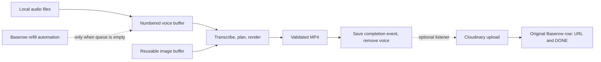

# Poetry Shorts Maker

Turn buffered voice recordings and local images into vertical MP4s with timed captions.
The video worker uses the filesystem queue. Baserow ingestion and Cloudinary
publication are optional automations running separately.



## Local quick start

Use Python 3.13 or 3.14 and FFmpeg/FFprobe with H.264 and libass support.
The font, background music and film overlay are included under `assets/`.

```sh
python3.13 -m venv .venv
.venv/bin/python -m pip install -r requirements-dev.txt
mkdir -p buffer/images
```

Copy still JPG, PNG, WebP or BMP images directly into `buffer/images/`.
Enqueue a voice with automatic, persistent numbering:

```sh
.venv/bin/python -m app.buffer add /path/to/recording.wav
# buffer/voiceovers/voice-000001.wav
```

The command copies the source, leaving your original intact. Supported voice
extensions are `.wav`, `.mp3`, `.m4a`, `.flac`, `.ogg`, `.aac`, `.opus` and `.audio`.
Directly placed files must follow the same `voice-000001.ext` pattern. Numbers
start at 1, are processed numerically, and must not be reused, even with another
extension. Prefer the add command so complete files and IDs are published together.
Gaps after a failed enqueue are allowed.

Export `WHISPER_API_KEY` securely in your shell. The default configuration uses
Groq's `whisper-large-v3` transcription API to obtain word and segment timestamps.
The local worker still needs this speech service; it needs no Baserow or Cloudinary
credentials, table IDs or cloud name. Native Python does not load `.env`.

Run one batch, open the dashboard, or keep polling for new voices:

```sh
.venv/bin/python -m app.buffer run
.venv/bin/python main.py
.venv/bin/python -m app.buffer run --watch
```

Only choose one worker at a time. The dashboard and API share the same buffer
lock. Dashboard **Start Processing** drains a snapshot; **Refresh Jobs** reads local
counts. An empty buffer succeeds without contacting any provider. `--watch` checks
again every five seconds. Both buffer commands accept `--config /path/to/local.yaml`.

The default filesystem layout is:

```text
buffer/
  voiceovers/
    voice-000001.wav       # Pending voice; consumed after rendering
    .queue/               # Persistent numbering, mappings and completion events
  images/                 # Reusable still images
output/
  voice-000001.mp4         # Finished reel with the same voice ID
temp/
  voice-000001/            # Per-voice working files and failure diagnostics
```

## Video composition

The renderer automatically uses the bundled assets for both normal processing
and the dev tool. Your inputs remain a voice recording and images.

- Choose one random track from `assets/music/` per reel; loop it as needed at
  **−12.0 dB** and mix it with the original voice at **+3.4 dB**.
- Loop the film-grain video from `assets/overlays/` over the footage with the
  **difference** blend mode. Its audio is excluded; captions are drawn afterwards.
- Give still images a gentle, shallow shake at a moderate pace, with overscan so edges
  stay covered. The overlay and captions remain steady.

Set `composition.music_directory` and `composition.overlay_file` in `config.yaml`
to change asset locations. `footage.random_seed` also reproduces music selection.
Gains are applied before mixing, without automatic mix normalization. Audio and
video are trimmed to the voice timeline. `composition.json` in retained working
files records the selected assets and mix settings; dev-tool reports include it.

## Completion and failures

- The planner randomly selects local images while composing the video. Images
  remain reusable; `footage.random_seed` can make selections repeatable.
- A successful render saves `output/voice-000001.mp4`, persists a completion event,
  and removes only that numbered voice from `buffer/voiceovers/`.
- Failed or cancelled rendering keeps the voice for the next explicit run. Watch
  mode retries on later polls. Failed work stays under `temp/voice-000001/`.
- A process interrupted during removal can finish it from the saved receipt on
  restart without rendering again. Unrelated manual deletions produce no success event.
- Keep `buffer/voiceovers/.queue/`: it contains sequence state, source mappings,
  completion events and optional delivery receipts. These are recovery state,
  not a disposable download cache. JSON replacement protects against partial
  reads; this is not a power-loss transaction across files and remote APIs.

## Optional provider automations

Enable these later, when you want remote ingestion and publication:

```sh
.venv/bin/python -m app.automations --watch
```

This separate service never renders. It listens to persisted completion events
and refills from Baserow only when there are no pending local voices. Start the
local worker separately (use its `--watch` mode for unattended processing).

For refill, configure `baserow.table_id` and supply `BASEROW_API_TOKEN` securely.
Set a distinct `baserow.images_table_id` if an empty local image pool should be
filled from Baserow. For publication, configure `cloudinary.cloud_name` and supply
`CLOUDINARY_API_KEY` and the actual `CLOUDINARY_API_SECRET` securely. Cloudinary
signing happens locally. Source/transcription media hosts must be reachable.
Baserow ingestion needs no Cloudinary credentials; publication is independent.

The audio table needs editable columns `ID`, `Audio URL`, `Status`, `Output File`,
`Output URL`, and `Error`. Ready rows use `NOT_PROCESSED`. The separate image table
needs `Image URL`. Use a Baserow database token with Read/Update access to audio rows
and Read access to images. Downloads must be direct HTTP(S) media links.

Refill imports pending voices into numbered files and remembers their original
server, table and internal row ID. It fills images if the local image pool is
empty. Local filenames never depend on editable sheet labels, and rows already
imported are not imported again while awaiting delivery.

For example, importing internal sheet row `92` as `voice-000001.audio` produces
`voice-000001.mp4`; the saved mapping sends its upload URL back to row `92`.
The voice sequence is a local queue ID, separate from the original sheet row ID.

For each consumed voice with a Baserow mapping, the listener:

1. Uploads its finished reel to Cloudinary.
2. Saves the confirmed upload URL locally.
3. Writes the URL and `DONE` to the original row in one acknowledged update.

An upload or sheet outage leaves local output and events available. A failed sheet
write retries using the saved URL, without another upload. An ambiguous upload
requires reconciliation using its delivery receipt; it is not blindly retried.
Unmapped local voices never cause a sheet update or an upload. Changed table/server
configuration is rejected for older events, protecting against the wrong sheet.

## Docker and API

The image includes Python 3.13, dependencies, FFmpeg and the bundled assets. Compose passes
values from `.env`; the native application does not. On Linux set `LOCAL_UID` and
`LOCAL_GID` to your user and group IDs before starting containers.

```sh
docker compose build dashboard
docker compose run --rm dashboard
# Alternative unattended local worker:
docker compose --profile worker up worker
# Optional, separate provider automation:
docker compose --profile automations up automations
```

Set `VIDEO_BUILDER_API_KEY` for the optional API, then run `python api.py` or
`docker compose --profile api up api`. Authenticated `GET /run` starts the same
local worker; `GET /status` reports its state. Both require `X-API-Key`.
See [operations](docs/operations.md) for configuration and recovery details.

## Development checks

```sh
.venv/bin/ruff check app tests devtools/video_test api.py main.py
.venv/bin/ruff format --check app tests devtools/video_test api.py main.py
.venv/bin/mypy
node --check devtools/video_test/static/app.js
.venv/bin/python -m pytest -q tests devtools/video_test/tests
```

Tests exercise real FFmpeg output and local HTTP downloads, including numbered
queue consumption, event recovery, provider isolation, upload ordering and sheet
retry behavior. External transcription, Baserow and Cloudinary are mocked; tests
do not establish successful paid transcription or live publication.
Renderer tests measure decoded audio gains, RGB difference blending, looping and
smooth image movement. CI includes the dev-tool suite as well as the core suite.
Container startup and live provider processing require separate validation.

See [architecture](docs/ARCHITECTURE.md) for the composition boundaries. The
[local media test tool](devtools/video_test/README.md) remains available for manual
voice/image testing. Historical [n8n examples](n8n/README.md) are optional integrations.
