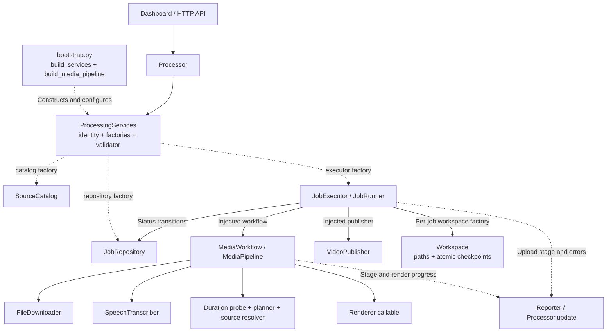

# Architecture and extension guide

[README](../README.md) · [Operations](operations.md) · [Critical code review](CODE_REVIEW.md)

The application runs one sequential batch at a time. The dashboard and API use the same `Processor`. Configuration remains compatible with the existing YAML, and default behavior remains Baserow → hosted transcription → local FFmpeg → Cloudinary.

## Responsibility boundaries



| Module | Responsibility | What to change here |
| --- | --- | --- |
| `processor.py` | Run ownership, thread lifecycle, cancellation, queue counts | Scheduling and run policy |
| `execution.py` | One job's status transitions, upload, failure recovery | Completion and recovery policy |
| `pipeline.py` | Download, transcription, planning, source resolution, rendering | Media stages and their ordering |
| `bootstrap.py` | Concrete adapter selection and configuration | Provider choices and default strategies |
| `contracts.py` | Narrow structural interfaces and factories | Contracts shared by callers and implementations |
| `models.py`, `timeline.py` | Provider-independent values and timeline rules | Domain behavior |
| `artifacts.py` | Workspace naming and atomic JSON replacement | Local artifact storage |
| `cancellation.py`, `ffmpeg.py` | Cancellation and subprocess execution | Shared execution primitives |
| `jobs.py`, `uploads.py`, `transcription.py`, `downloads.py`, `images.py` | External formats, HTTP, validation and adapter-specific retries | Provider integration details |

`Processor(config)` remains supported and selects the default composition. `Processor(config, services)` accepts an explicit `ProcessingServices`. The default constructor imports the composition root lazily; injected application tests do not construct default providers.

The `identity` in `ProcessingServices` defines the shared lock namespace. It must be stable across processes using the same job queue. Baserow defaults to server URL plus audio-table ID. Do not use random identities in production; tests use them for isolation.

## Successful job sequence

This sequence shows the default composition after the coordinator has read the job snapshot and source pool. Providers satisfy protocols structurally; they are created by factories rather than directly by the coordinator.

```mermaid
sequenceDiagram
    participant Processor
    participant Runner as JobRunner
    participant Repo as JobRepository
    participant Work as Workspace
    participant Media as MediaWorkflow
    participant Publisher as VideoPublisher

    Processor->>Runner: run(job, repository, sources)
    Runner->>Work: prepare unique workspace
    Runner->>Repo: update(job, PROCESSING)
    Repo-->>Runner: acknowledged
    Runner->>Media: run(job, workspace, sources, stop, report)
    Note over Media,Work: Download and probe audio; transcribe and save transcript.json
    Note over Media,Work: Plan, buffer selected images and render validated MP4
    Media-->>Runner: media workflow finished
    Runner->>Work: write rendered.json
    Runner->>Publisher: public_id(output)
    Publisher-->>Runner: intended remote identifier
    Runner->>Work: write upload.json
    Runner->>Publisher: upload(output, progress)
    Publisher-->>Runner: confirmed UploadResult
    Runner->>Work: write uploaded.json
    Note over Runner,Repo: A Stop received with the final upload response does not cancel the DONE update
    Runner->>Repo: update(job, DONE, output, uploaded_url)
    Repo-->>Runner: acknowledged
    Runner->>Work: clean temporary workspace
    Runner-->>Processor: True
    Note over Processor: Increment completed count; continue unless stopped
```

On a per-job exception, `JobRunner` independently attempts `failure.json` and, if `PROCESSING` was acknowledged, a `FAILED` update. It returns `False` so the coordinator can count the failure and continue. A cancellation sets the shared event, which prevents the next job from starting. Failure to remove successful temporary work is logged and still returns success. Full recovery rules appear [below](#recovery-and-cancellation-contracts).

## SOLID choices

- **Single responsibility:** queue coordination, media creation, publication/recovery, and filesystem checkpoints have separate owners.
- **Open/closed:** replace a repository, catalog, transcription provider, publisher, planner, resolver, or renderer through composition. New stages belong in `MediaPipeline` or a replacement `MediaWorkflow`; the queue need not change.
- **Liskov substitution:** implementations must honor behavioral contracts below, especially cancellation and acknowledged completion. Structural typing alone cannot enforce those semantics.
- **Interface segregation:** a repository does not have to provide images, and a source catalog does not have to update jobs. Baserow's adapter can serve both through the default composition.
- **Dependency inversion:** application services consume protocols and callables. `bootstrap.py` owns concrete provider selection. Provider-independent cancellation no longer requires importing the video renderer.

There is no runtime plugin discovery or inheritance framework. Plain classes satisfying a protocol and injected functions are sufficient. Tests exercise those boundaries with in-memory adapters.

## Replace the publisher

Implement `VideoPublisher.public_id(path)` and `upload(path, progress)`. The identifier must be known before upload so recovery metadata can record the intended remote object. `upload` must return `UploadResult` only after validating the complete remote upload. Raise on ambiguous completion and preserve the identifier for manual reconciliation.

The following composition helper accepts a publisher factory and its credential validator. It retains the default media pipeline and repository without constructing a Cloudinary uploader:

```python
from copy import deepcopy
from dataclasses import replace
from functools import partial

from app.artifacts import Workspace
from app.bootstrap import build_media_pipeline, build_services
from app.config import (
    check_render_config,
    check_source_config,
    check_transcription_config,
)
from app.execution import JobRunner
from app.processor import Processor


def processor_with_publisher(config, publisher_factory, validate_publisher):
    config = deepcopy(config)
    services = build_services(config)

    def validate():
        check_source_config(config)
        check_transcription_config(config)
        check_render_config(config)
        validate_publisher()

    def executor(stop, report):
        return JobRunner(
            media=build_media_pipeline(config, stop),
            publisher=publisher_factory(stop),
            workspace=partial(Workspace.for_job, config["paths"]),
            stop=stop,
            report=report,
        )

    return Processor(config, replace(services, executor=executor, validate=validate))
```

Inject the resulting processor into `create_app(processor=processor)` or `Dashboard(processor, live_logs)`. Validate only the providers actually selected. Adding custom YAML sections also requires extending `DEFAULTS` and `validate_config`; unknown keys deliberately fail early.

## Other feature changes

| Feature | Extension point | Behavioral constraint |
| --- | --- | --- |
| Another job store | `ProcessingServices.repository` and `identity` | Stable job IDs; updates address the original record |
| Local or remote media catalog | `ProcessingServices.catalog` | Return `Source` values; supply a resolver compatible with them |
| Another speech provider | `MediaPipeline.transcriber` | Return ordered, finite word timestamps within the audio duration |
| New footage-selection rule | `MediaPipeline.plan` | Cover the full audio duration; preserve caption words |
| Video backgrounds | Catalog plus `MediaPipeline.resolve` | Default resolver handles remote still images; videos need buffering, probing and validation |
| Another encoder | `MediaPipeline.render` | Return only after a complete validated output is finalized atomically |
| Extra media stage | `MediaPipeline.run` or another `MediaWorkflow` | Check cancellation before expensive work and retain diagnostic artifacts |
| Different caption-cut semantics | Planner plus renderer validation | Default renderer intentionally enforces the existing footage and caption invariants |

Use `dataclasses.replace(build_media_pipeline(config, stop), transcriber=...)` to change a media dependency. Supply an executor factory using that pipeline and adjust its validator. This does not require changes to `Processor` or `JobRunner`.

## Recovery and cancellation contracts

1. Prepare a unique workspace and acknowledge `PROCESSING` before media work.
2. Produce a validated MP4, record `rendered.json`, then write `upload.json` before uploading.
3. Persist a confirmed result in `uploaded.json`, then acknowledge `DONE` in the repository.
4. Commit an acknowledged upload even when Stop arrives with the final response. Recovery updates deliberately omit the cancelled event.
5. On failure, independently attempt diagnostic persistence and a `FAILED` update. A diagnostic failure must not prevent recovery or later jobs.
6. Keep complete outputs after upload or repository failure. Remove successful temporary work only after `DONE` is acknowledged.

`Reporter` callbacks must accept keyword state updates and must not throw. The built-in reporter isolates shared-status filesystem errors. `MediaWorkflow` and renderer implementations must not raise after successfully finalizing output: the runner treats a raised media exception as incomplete work. `JobExecutor.run` returns success only for acknowledged completion and handles expected per-job failures itself; an unexpected executor exception terminates the batch visibly.

Atomic JSON replacement prevents partially written documents from being observed. It does not provide power-loss durability or an atomic transaction with either external service. See the [review](CODE_REVIEW.md#remaining-limitations-and-decisions) and [operations recovery instructions](operations.md#recovery) before adding automatic retries.

## Development checks

Use Python 3.13 (the Docker runtime) or 3.14 with FFmpeg/FFprobe installed:

```sh
python -m venv .venv
.venv/bin/python -m pip install -r requirements-dev.txt
.venv/bin/ruff check app tests api.py main.py
.venv/bin/ruff format --check app tests api.py main.py
.venv/bin/mypy
.venv/bin/python -m pytest -q
```

On Windows use the corresponding `.venv/Scripts` executables. Tests need permission to bind a localhost HTTP server. Provider calls are mocked; rendering and local downloads are real. Never add live paid-provider calls to this suite.

Mypy currently checks eight modules: contracts, models, cancellation, artifacts, pipeline, execution, processor and bootstrap. Existing adapters and dictionary-based YAML configuration are not fully typed. Expand coverage as those modules change. CI defines Python 3.13 and 3.14 jobs with formatting, lint, typing and tests; local success does not imply the hosted workflow has already run.
