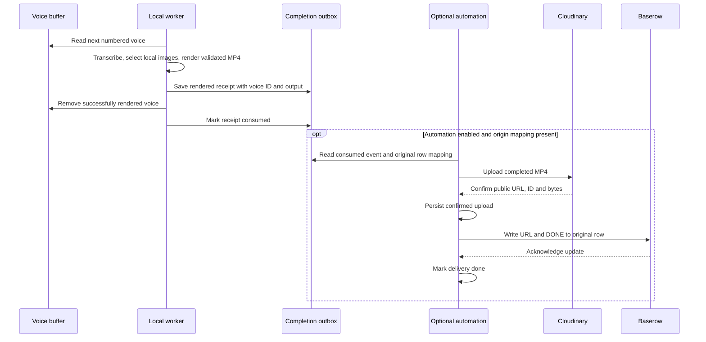

# Architecture and extension guide

The default video worker owns a local numbered voice queue. Remote ingestion and
publication are independent optional adapters.

## Responsibility boundaries

| Component | Responsibility |
| --- | --- |
| `VoiceBuffer` in `app/buffer.py` | Strict numbering, atomic enqueue, source metadata and completion outbox |
| `LocalImages` | Reusable local image candidates |
| `Processor` | Sequential scheduling, cancellation, shared lock and observable counts |
| `BufferRunner` | Render one buffered voice; save event and consume source on success |
| `MediaPipeline.run_local()` | Probe audio, transcribe, plan, resolve local media and render |
| `bootstrap.build_services()` | Compose the local default without Baserow or Cloudinary |
| `BufferAutomations` | Optional empty-queue refill and completion-event delivery |
| `JobTable` / `Uploader` | Provider-specific HTTP requests, authentication and upload confirmation |

The dashboard, HTTP API and buffer CLI all use the same default Processor.
Transcription remains injectable; the default adapter uses the configured hosted
speech API. The queue and renderer do not require a Baserow table or Cloudinary
account. Remote provider modules are not imported by the default composition.

## Local sequence

1. Enqueue copies an audio file to the next `voice-NNNNNN.ext` name. A metadata
   lock serializes allocation; a persistent high-water mark prevents ID reuse.
   Incomplete copies are hidden and never become queued inputs.
2. Processor snapshots numbered voices in numeric order, under its run lock.
3. Local image candidates are snapshotted once. The timeline planner selects
   random images at eligible sentence boundaries; it never queries a sheet.
4. `run_local` operates on the existing voice path and creates a validated MP4
   with the same voice ID. It never downloads the voice or publishes the result.
5. BufferRunner saves a `rendered` receipt, removes that voice, and marks the
   receipt `consumed`. Failed rendering retains the input and emits no event.
6. Successful temporary work is cleaned. Images, output, sequence state, source
   metadata and events remain. An empty queue needs no provider credentials.

A saved rendered receipt can finish interrupted removal without re-rendering.
Receipt replacement is atomic for readers, not a transaction against power loss.
The queue's metadata lock and the scheduling lock serve different purposes;
enqueue can run while an existing snapshot renders.



## Optional automation sequence

`python -m app.automations --watch` polls every five seconds. It does not render.
Refill returns immediately for a nonempty voice queue without constructing a
Baserow adapter. When empty, it imports pending rows, validates downloaded audio,
seeds images if necessary, and enqueues numbered voices with opaque origin
metadata. Origins preserve server, table, internal row ID and display label.
Retained mappings prevent reimport while the sheet awaits its final update.

Voice identity and provider identity remain separate:

| Value | Example | Used for |
| --- | --- | --- |
| Local sequence / stem | `1` / `voice-000001` | Queue ordering, input, output and event names |
| Original server and table | `https://api.baserow.io`, table `51` | Preventing delivery to a different source |
| Original internal row ID | `92` | Addressing the sheet update after upload |
| Editable sheet `ID` label | `poem-001` | Display metadata; never used to address writes |

The completion event copies the origin mapping before removing the voice, so
publication does not need to reconstruct identity from a deleted input filename.
Persisted state lives under `buffer/voiceovers/.queue/`: `sequence.json` reserves
numbers, `voice-*.json` retains ingestion mappings, `completed/` holds render and
consumption receipts, and `delivery/` holds optional upload/acknowledgement receipts.

The completion listener reads the outbox rather than listening to arbitrary
filesystem unlink events. A manual deletion cannot represent a validated video.
For mapped consumed events it checkpoints the intended upload ID, uploads,
checkpoints the confirmed URL, then acknowledges the URL and DONE together on the
original row. Local-only events have no remote effect. Changing the configured
server/table cannot redirect an older completion to another sheet.

A failed sheet write reuses the confirmed upload. An ambiguous upload requires
reconciliation rather than a blind retry. Per-event failures do not stop other
events, and delivery failures do not prevent the independent refill attempt.
See [recovery](operations.md#recovery).

## Extension contracts

`ProcessingServices` still accepts repository, catalog and executor factories for
custom scheduling compositions. `Job` is the existing scheduling DTO: locally,
`row` holds the sequence, `id` the voice stem, and `voice_link` the local path.
The opaque origin metadata carries the separate remote row identity. Local
completion does not call the remote repository update contract.

`MediaPipeline.run()` and `JobRunner` retain the explicit remote-first injected
workflow for existing callers/tests; they are not selected by main.py, api.py or
the buffer CLI. The default path calls `run_local()` and `BufferRunner`.
`VideoPublisher` remains the upload boundary. Add providers in the optional
adapter layer rather than teaching the local worker about remote table schemas.

Cancellation checks run before expensive stages. Once the renderer successfully
finalizes, the local runner attempts to record and consume the voice even if stop
arrives at that boundary. Status reporting failures remain outside media policy.

## Development checks

```sh
.venv/bin/ruff check app tests api.py main.py
.venv/bin/ruff format --check app tests api.py main.py
.venv/bin/mypy
.venv/bin/python -m pytest -q
```

Core interface type checks cover the modules listed in pyproject.toml. Tests use
real local media and FFmpeg, with external provider responses mocked. Architecture
tests guard the default composition and core against Baserow/Cloudinary imports.
The buffer workflow change passed 152 tests and the listed lint, formatting and
type checks on Python 3.13. `docker compose config --quiet` also passed; actual
container startup and live provider processing remain outside that validation.
